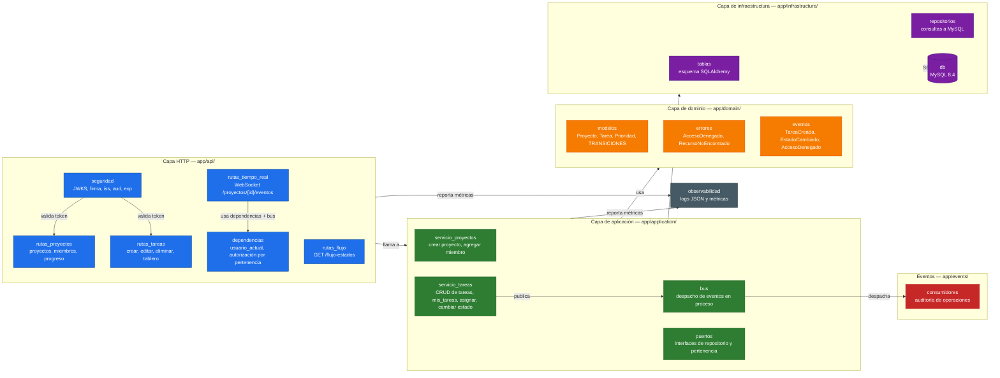

# C4 — Nivel 3: Componentes de la API

Desglosa el contenedor **API** del [nivel 2](nivel2-contenedores.md) en los componentes internos
del paquete `app/`, con sus responsabilidades y las dependencias entre ellos. No es un despliegue
separado: todos viven dentro del mismo proceso de la API (FastAPI), el estilo es sincrónico con
eventos en proceso ([ADR 0006](../adr/0006-estilo-sincrono-con-eventos-en-proceso.md)).

## Diagrama de componentes

## Tabla de componentes

| Componente | Responsabilidad | Archivo |
|------------|-----------------|---------|
| `rutas_proyectos` | Endpoints de proyectos, miembros y progreso | `app/api/rutas_proyectos.py` |
| `rutas_tareas` | Endpoints de tareas (crear, editar, eliminar, tablero) | `app/api/rutas_tareas.py` |
| `rutas_flujo` | `GET /flujo-estados`: estados, etiquetas y transiciones | `app/api/rutas_flujo.py` |
| `rutas_tiempo_real` | WebSocket de notificaciones por proyecto | `app/api/rutas_tiempo_real.py` |
| `dependencias` | Resolución del usuario actual y autorización por pertenencia | `app/api/dependencias.py` |
| `seguridad` | Validación del token OIDC contra JWKS | `app/api/seguridad.py` |
| `tiempo_real` | Gestor de conexiones WebSocket | `app/api/tiempo_real.py` |
| `servicio_proyectos` | Caso de uso: crear proyecto, agregar miembro | `app/application/servicio_proyectos.py` |
| `servicio_tareas` | Caso de uso: CRUD, mis_tareas, asignar, cambiar estado | `app/application/servicio_tareas.py` |
| `bus` | Despacho de eventos de dominio en proceso | `app/application/bus.py` |
| `puertos` | Interfaces de repositorio y pertenencia | `app/application/puertos.py` |
| `modelos` | Entidades, estados y flujo de transiciones | `app/domain/modelos.py` |
| `errores` | Excepciones de dominio | `app/domain/errores.py` |
| `eventos` | Eventos de dominio (TareaCreada, EstadoCambiado…) | `app/domain/eventos.py` |
| `consumidores` | Consumidores de auditoría de eventos | `app/events/consumidores.py` |
| `tablas` | Esquema SQLAlchemy (proyectos, miembros, tareas…) | `app/infrastructure/tablas.py` |
| `repositorios` | Consultas de persistencia y progreso | `app/infrastructure/repositorios.py` |
| `db` | Motor y sesión de MySQL | `app/infrastructure/db.py` |
| `observabilidad` | Logs JSON por petición y métricas Prometheus | `app/observabilidad.py` |

## Límites del nivel 3

- El bus y los consumidores son **en proceso**: no hay broker ni cola externa ([ADR 0006](../adr/0006-estilo-sincrono-con-eventos-en-proceso.md), [ADR 0015](../adr/0015-taller-de-mensajeria-local-aislado.md)). Si la instancia de la API cae, los eventos en vuelo se pierden.
- La base de datos es el único almacén duradero; no hay caché de datos de negocio desplegada.
- La caché JWKS vive en memoria dentro de la API, no es un componente independiente.

## Correspondencia con el C4 de nivel 2

Cada componente de este nivel pertenece al contenedor «API» del [nivel 2](nivel2-contenedores.md). Los contenedores «Aplicación Web», «Base de datos» y «Proveedor de identidad» no se desglosan aquí porque no añaden componentes internos relevantes para la trazabilidad del corte.
