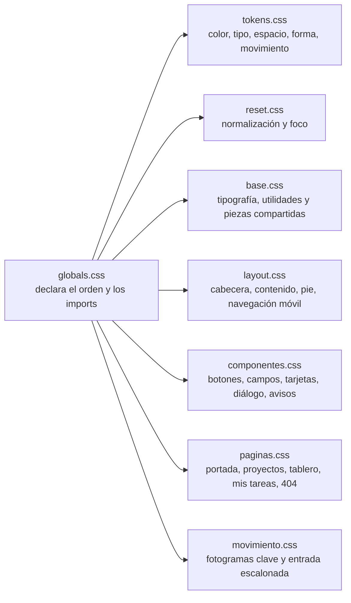

# Sistema visual de UniTeam — identidad «Atlas»

Este documento describe cómo se ve y cómo se construye la interfaz de UniTeam. No
sustituye al código: lo explica para que cualquier integrante pueda extenderlo sin
inventar colores, tamaños ni capas nuevas. La decisión que lo respalda es la
[ADR-017](../adr/0017-sistema-visual-editorial-y-css-por-capas.md).

## 1. Propósito y alcance

La reconstrucción de 2026-11-19 cambió **solo la presentación** del frontend. Ni una
pantalla, un formulario, un botón ni una llamada a la API cambiaron de comportamiento:
el inventario de funciones y su verificación están en
[`inventario-funciones.md`](inventario-funciones.md).

El sistema visual sirve a dos escenarios de calidad:

- **[ESC-02](../calidad/escenarios-calidad.md#esc-02) (usabilidad):** jerarquía clara,
  estados visibles y textos que explican qué hacer.
- **[ESC-05](../calidad/escenarios-calidad.md#esc-05) (modificabilidad):** un cambio de
  color o de tipografía se hace en un archivo de tokens, no en cincuenta reglas.

## 2. Principios

1. **Papel antes que pantalla.** El fondo es papel cálido, no blanco de laboratorio.
   Las superficies se apoyan con una sombra corta y un borde de tinta diluida.
2. **La tipografía hace el trabajo.** Los títulos van en una serif variable con
   carácter; la interfaz, en una sans geométrica y callada. No se usan mayúsculas
   sostenidas ni degradados para dar énfasis.
3. **Un acento, no cinco.** El cobalto es la voz de la marca; la terracota señala lo que
   pide atención; el resto de colores solo aparece en estados (prioridad, vencimiento,
   error).
4. **El movimiento se posa.** Las transiciones son cortas y con desaceleración; nada
   rebota, nada gira sin motivo. Todo respeta `prefers-reduced-motion`.
5. **Una sola fuente de verdad.** Ningún componente escribe un color en hexadecimal:
   pide un token semántico.
6. **Cada capa tiene un oficio.** Los tokens deciden, el reset normaliza, la base tipa,
   el layout coloca, los componentes visten y las páginas componen.

## 3. Arquitectura CSS



`web/app/globals.css` solo declara el contrato de precedencia y los imports:

```css
@layer tokens, reset, base, layout, componentes, paginas, utilidades;

@import "./estilos/tokens.css";
/* … */
```

Consecuencias de usar capas:

- **No hay `!important` en toda la hoja.** La precedencia se lee en una línea.
- Una página puede ajustar un componente sin reescribirlo: `paginas` gana a
  `componentes`.
- Las utilidades (`.solo-lectores`, `.saltar`, `.esqueleto`) viven en `base` y
  `movimiento`, y no compiten con la identidad visual.

> **Regla de mantenimiento:** una regla nueva entra en la capa de su oficio. Si hay que
> añadir una capa, se documenta aquí y en la ADR.

## 4. Color

La paleta se declara **una sola vez** con `light-dark()` y `color-scheme`. El tema
oscuro no es un segundo bloque de variables que pueda desincronizarse: es la otra cara
del mismo token.

```css
:root {
  color-scheme: light dark;
  --papel: light-dark(#f7f4eb, #101814);
  --tinta: light-dark(#1b2a23, #f0ede3);
  --verde: light-dark(#2e5c49, #9cc0a3);
}
:root[data-theme="light"] { color-scheme: light; }
:root[data-theme="dark"]  { color-scheme: dark; }
```

La preferencia explícita del usuario se guarda en `localStorage` (`uniteam-tema`) y se
aplica antes de pintar con un script `beforeInteractive`; si no hay preferencia, manda
`prefers-color-scheme` y el selector se actualiza al cambiar el sistema.

### 4.1 Paleta cruda

| Token | Claro | Oscuro | Uso |
|---|---|---|---|
| `--papel` | `#f7f8fc` | `#0d1624` | Fondo de la aplicación. |
| `--papel-2` | `#f0f3f8` | `#1b2d43` | Superficie hundida: columnas, métricas, pistas. |
| `--blanco` | `#ffffff` | `#142235` | Superficie elevada: tarjetas, campos, modal. |
| `--tinta` | `#172538` | `#f3f6fc` | Texto principal. |
| `--tinta-suave` | `#637083` | `#a8b5c7` | Texto secundario. |
| `--tinta-tenue` | `#8a93a3` | `#7e8ca0` | Metadatos y iconos. |
| `--linea` | `#e4e9f0` | `#2b3b50` | Bordes y separadores. |
| `--linea-fuerte` | `#c9d2df` | `#3a4d66` | Bordes de controles y separadores fuertes. |
| `--linea-campo` | `#7a8699` | `#5a6b85` | Borde de campos y botones secundarios: su único límite visible, cumple 3:1. |
| `--verde` (cobalto) | `#315c9b` | `#8db4ed` | Marca y acción principal. |
| `--terracota` (terracota) | `#b45529` | `#e58a60` | Acento decorativo. |
| `--rojo` | `#b42318` | `#f28b82` | Prioridad alta, error, vencida. |
| `--ocre` | `#a85b14` | `#f0b46d` | Prioridad media, aviso. |
| `--salvia` | `#167a55` | `#67c69a` | Prioridad baja, éxito. |
| `--azul` | `#315c9b` | `#8db4ed` | Información y estado. |

Cada color tiene su pareja `-claro` para fondos de pastilla, aviso o métrica.

### 4.2 Tokens semánticos

Los componentes no usan la paleta cruda: usan `--fondo`, `--superficie`,
`--superficie-2`, `--borde`, `--borde-fuerte`, `--borde-campo`, `--texto`, `--texto-suave`,
`--texto-tenue`, `--primario`, `--primario-fuerte`, `--primario-suave`,
`--sobre-primario`, `--acento`, `--acento-suave`, `--peligro`, `--aviso`, `--exito`,
`--info` y sus `-suave`, más `--foco`.

Así, cambiar la marca es cambiar `--verde`; el resto se recalcula.

### 4.3 Contraste medido

Ratios calculados sobre los valores finales (WCAG 2.1, luminancia relativa). El mínimo
exigido a texto normal es 4.5:1 y a texto grande o elementos de interfaz, 3:1.

> Paleta cambiada el 2026-11-20 a «Aprendizaje Vivo» (teal + coral). Los ratios de
> abajo corresponden a la paleta anterior (Editorial Campus) y deben recalcularse con
> la nueva paleta antes de cerrar la entrega; la estructura de pares no cambia.

| Par | Claro | Oscuro |
|---|---|---|
| Texto sobre fondo | 13.62:1 | 15.42:1 |
| Texto suave sobre fondo | 6.15:1 | 9.94:1 |
| Texto tenue sobre fondo | 4.83:1 | 6.14:1 |
| Primario sobre fondo | 6.96:1 | 9.01:1 |
| Sobre-primario sobre primario | 7.53:1 | 9.25:1 |
| Peligro sobre peligro suave | 5.11:1 | 6.61:1 |
| Aviso sobre aviso suave | 4.86:1 | 8.09:1 |
| Éxito sobre éxito suave | 4.96:1 | 7.42:1 |
| Info sobre info suave | 5.57:1 | 7.42:1 |
| Acento sobre acento suave | 5.10:1 | 6.32:1 |

`--texto-tenue` se usa solo sobre `--fondo` o `--superficie`; sobre `--superficie-2`
—más oscura en claro— se usa `--texto-suave`. Esa es la razón de que las etiquetas de
las métricas y los textos de columna vacía pidan el token suave.

## 5. Tipografía

| Rol | Familia | Token | Dónde |
|---|---|---|---|
| Voz editorial | **Fraunces** (serif variable) | `--tipo-display` | `h1`–`h4`, cifras grandes, nombre de la marca. |
| Interfaz | **Manrope** (sans variable) | `--tipo-ui` | Cuerpo, botones, campos, etiquetas. |

Ambas se cargan con `next/font/google`, que **descarga las fuentes en el build y las
sirve desde el mismo sitio**: en tiempo de ejecución no hay peticiones a Google, no hay
parpadeo de texto invisible y el sitio exportado sigue siendo estático (9 archivos
`.woff2` en `out/_next/static/media`). Es el único punto del build que necesita red: en
un entorno sin salida a `fonts.googleapis.com`, `npm run build` falla y habría que
volver a una pila del sistema o usar `next/font/local` con los archivos versionados.

Fraunces se usa con sus ejes ópticos: `font-variation-settings: "SOFT" 30, "WONK" 0`
para los títulos y `"SOFT" 80, "WONK" 1` en la cursiva de la portada, que es el único
lugar donde el eje *wonk* se enciende.

### 5.1 Escala

| Token | Tamaño | Uso |
|---|---|---|
| `--texto-2xs` | 11 px | Pastillas, cejas, contadores. |
| `--texto-xs` | 12 px | Metadatos, fechas, ayudas. |
| `--texto-sm` | 13 px | Cuerpo de tarjetas, botones, campos. |
| `--texto-base` | 15 px | Cuerpo general. |
| `--texto-md` | 16 px | Entradillas y botones grandes. |
| `--texto-lg` | 18 px | Títulos de tarjeta y de sección. |
| `--texto-xl` | 22 px | Cifras y títulos de panel. |
| `--texto-2xl` | `clamp(1.55rem … 2.15rem)` | Título de modal y de estado vacío. |
| `--texto-3xl` | `clamp(2rem … 3rem)` | Título de página. |
| `--texto-hero` | `clamp(2.5rem … 4.6rem)` | Portada. |

Los títulos llevan `text-wrap: balance`; los párrafos, `text-wrap: pretty`. El
interletrado se aprieta a medida que el tamaño crece (`-0.035em` en la portada,
`-0.006em` en el cuerpo).

## 6. Espacio, forma y elevación

- **Espacio:** escala de 4 px (`--e-1` = 4 px … `--e-9` = 96 px). Los saltos grandes
  usan `--e-7`/`--e-8`; dentro de una tarjeta, `--e-2` a `--e-4`.
- **Radios:** `--r-xs` 4, `--r-sm` 8, `--r-md` 12, `--r-lg` 18, `--r-xl` 26,
  `--r-full` 999. Las tarjetas de tarea usan `--r-md`; los paneles, `--r-lg`.
- **Elevación:** tres sombras tintadas de verde, nunca gris puro. `--sombra-1` para
  reposo, `--sombra-2` para *hover*, `--sombra-3` para modal y portada.

## 7. Movimiento

| Token | Valor | Uso |
|---|---|---|
| `--dur-1` | 120 ms | Color, borde, opacidad. |
| `--dur-2` | 180 ms | Elevación y desplazamiento corto. |
| `--dur-3` | 260 ms | Entrada de modal, avisos y paneles. |
| `--dur-4` | 460 ms | Entrada de la portada y barras de progreso. |
| `--ease` | `cubic-bezier(.2,.7,.2,1)` | Desaceleración única del sistema. |

Fotogramas clave en `movimiento.css`: `subir`, `aparecer`, `deslizar-aviso`,
`encoger`, `girar`, `flotar`, `posar`, `brillar`.

`prefers-reduced-motion: reduce` desactiva animaciones y transformaciones de *hover*;
las transiciones quedan en 0.01 ms desde `reset.css`. Nada de información depende del
movimiento: el estado siempre está también en texto, color y posición.

## 8. Componentes

| Clase | Pieza | Archivo |
|---|---|---|
| `.boton`, `.secundario`, `.icono`, `.pequeno`, `.grande` | Botones | `componentes.css` |
| `.campo`, `.etiqueta`, `.campos`, `.acciones` | Formularios | `componentes.css` |
| `.tarjeta`, `.formulario` | Superficies | `componentes.css` |
| `.selector-tema` | Interruptor claro/oscuro | `componentes.css` |
| `.fondo-modal`, `.modal`, `.segmentado`, `.segmento` | Diálogo de tarea | `componentes.css` |
| `.aviso`, `.aviso-flotante`, `.aviso-barra` | Avisos en página y flotantes | `componentes.css` |
| `.filtros`, `.campo-busqueda`, `.filtro`, `.interruptor` | Búsqueda y filtros | `componentes.css` |
| `.panel-miembros`, `.lista-miembros` | Integrantes | `componentes.css` |
| `.anillo`, `.barra`, `.pastilla`, `.insignia`, `.avatar` | Piezas compartidas | `base.css` / `componentes.css` |
| `.columna`, `.tarjeta-tarea`, `.fila-tarea`, `.kanban` | Tablero | `paginas.css` |
| `.portada-*`, `.ilustracion-*`, `.ventaja` | Portada | `paginas.css` |
| `.vacio-grande`, `.no-encontrado` | Estados vacíos y 404 | `paginas.css` |

Los iconos son SVG en línea (`web/app/componentes/iconos.tsx`), con `currentColor` y
`aria-hidden`. No hay fuente de iconos ni dependencia nueva.

## 9. Patrones de página

- **Portada (`/`):** titular editorial con una ilustración construida en HTML y CSS
  —un tablero inclinado, un anillo de avance y fichas flotantes—. No es una imagen: se
  adapta al tema, no pesa y se anima con la misma curva que el resto.
- **Proyectos:** encabezado con ceja, título y acción; formulario de alta en una
  tarjeta; rejilla de tarjetas con anillo de avance y avatares del equipo.
- **Tablero (`/proyecto/?id=`):** resumen con anillo y cuatro métricas, aviso de
  límite, barra de búsqueda y filtros, y columnas Kanban. La columna de destino se
  ilumina al arrastrar; las tarjetas muestran prioridad en el lomo izquierdo.
- **Mis tareas:** bandejas por vencimiento, con punto de color por grupo y enlace al
  proyecto de cada tarea.
- **Callback y 404:** tarjetas centradas con un icono, una explicación y una salida.

## 10. Accesibilidad

- Enlace **«Saltar al contenido»** como primer elemento enfocable; `main#contenido`
  recibe el foco con `tabIndex={-1}`.
- `:focus-visible` global con anillo de coral y desplazamiento de 2 px.
- El diálogo de tarea abre con el foco dentro, cierra con `Escape` y **devuelve el foco**
  al botón que lo abrió.
- Los avisos flotantes usan `role="status"`; los errores, `role="alert"`.
- Los botones de icono tienen `aria-label`; los campos, etiqueta o `aria-label`; los
  errores de formulario se asocian con `aria-describedby` y `aria-invalid`.
- Los objetivos táctiles de la navegación móvil miden 62 px de alto; los botones de
  icono, 30 px con área de pulsación ampliada por el *padding* del contenedor.
- Ningún texto informativo baja de 4.5:1 (tabla de §4.3).

## 11. Responsive

| Ancho | Cambio |
|---|---|
| ≤ 520 px | Portada sin fichas flotantes; rejilla de proyectos en una columna. |
| ≤ 720 px | Navegación superior oculta; aparece la barra inferior con «Proyectos» y «Mis tareas»; la cabecera reduce el selector de tema a icono. |
| ≤ 760 px | Kanban en una columna; métricas en dos; las filas de tarea se apilan. |
| ≤ 900 px | Portada en una columna; ventajas apiladas; el correo del usuario se oculta. |
| > 1180 px | El contenido se centra con `--ancho`; los márgenes crecen, la medida de lectura no. |

La barra inferior respeta `env(safe-area-inset-bottom)` y el `body` reserva su altura
para que el pie nunca quede tapado.

## 12. Cómo extender el sistema

1. **¿Falta un color?** Añade un token en `tokens.css` con sus dos caras
   (`light-dark`). No escribas hexadecimales en componentes.
2. **¿Falta un tamaño?** Usa la escala `--texto-*` o `--e-*`. Si de verdad no encaja,
   añade el token y justifícalo en la revisión.
3. **¿Una pieza nueva?** Va en `componentes.css` con una clase con nombre en español,
   como el resto. Si solo la usa una página, va en `paginas.css`.
4. **¿Un ajuste de página sobre un componente?** Va en `paginas.css`; nunca
   `!important`.
5. **¿Una animación?** Fotograma en `movimiento.css` y entrada en la lista de
   `prefers-reduced-motion`.
6. **¿Un cambio de marca?** Cambia `--verde`, `--terracota` y las fuentes; el resto del
   sistema se recalcula.

## 13. Verificación

| Comprobación | Resultado |
|---|---|
| `npx tsc --noEmit` | Sin errores. |
| `npm run build` (export estático) | Compila; rutas `/`, `/callback/`, `/mis-tareas/`, `/proyecto/`, `/404.html`, `/icon.svg`. |
| Cobertura de clases | 164 clases usadas en TSX; todas con regla o variante dinámica documentada. |
| Capturas | Portada, proyectos, tablero y mis tareas a 1440 px y 390 px, en claro y oscuro, con Edge headless vía CDP. |
| Fuentes | 9 `.woff2` servidos desde el propio sitio; ninguna petición a Google en ejecución. |
| Contraste | Tabla de §4.3, calculada sobre los valores finales. |

Las capturas y la API simulada usadas para revisar el tablero con sesión viven fuera
del repositorio, en la carpeta temporal de revisión: no son parte del producto.
